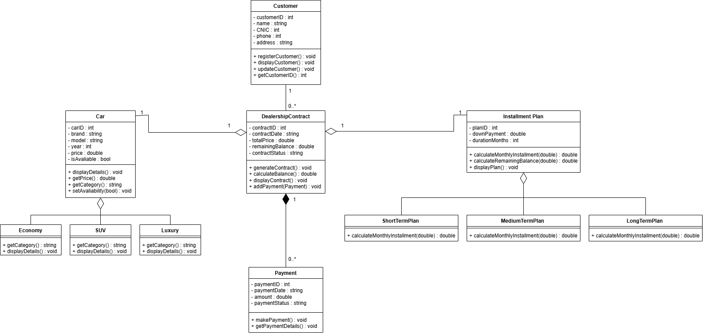

# Car-Dealership-Installment-Management-System
It is a Object-Oriented-Programming C++ Project. A digital system designed for Car Dealerships to maintain the Installments.To manage the customer data,installment plans realative to different car categories.

